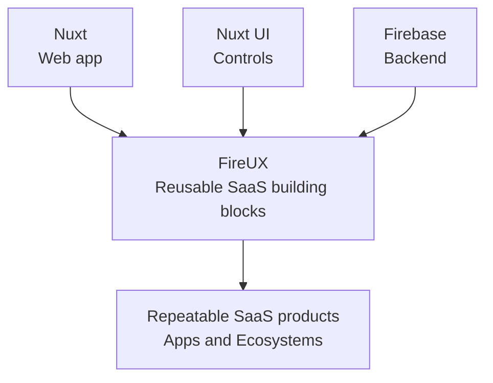

# FireUX platform map

Updated: 2026-11-16
Ref: e7fa1f63c
Role: map, not canon

## Purpose and authority

Use this as the short entrypoint from Nuxt, Nuxt UI and Firebase into the
FireUX-specific architecture. Official upstream docs own framework behavior.
This map and the linked FireUX contexts record package integration, product
ownership, data authority and intentional policy.

Current manifests, package registration and runtime source establish what is
implemented. Product decisions define the intended boundary. This map is not an
audit of every App, Entity or deployed Firebase target.

## Guiding principle

> Nuxt runs the web app, Nuxt UI supplies the controls, Firebase supplies the backend, and FireUX composes them into repeatable SaaS products.

FireUX supplies the shared product contracts and composition that let these
foundations work consistently across Apps. Ignition owns App scaffolding and
build reconciliation.

Use native behavior by default. Each FireUX abstraction must own a specific
product responsibility or resolve a demonstrated integration gap. Review it
against that responsibility before adding another layer.

## Platform foundations

| Foundation                    | Upstream documentation                                                                                                                                                                                                                                                                                                                                                                         | FireUX integration                                                                                                                                                                                                                                                                                                                                                                    |
| ----------------------------- | ---------------------------------------------------------------------------------------------------------------------------------------------------------------------------------------------------------------------------------------------------------------------------------------------------------------------------------------------------------------------------------------------- | ------------------------------------------------------------------------------------------------------------------------------------------------------------------------------------------------------------------------------------------------------------------------------------------------------------------------------------------------------------------------------------- |
| Nuxt 4 and Vue                | [Nuxt 4](https://nuxt.com/docs/4.x/getting-started/introduction), [modules](https://nuxt.com/docs/guide/concepts/modules), [layers](https://nuxt.com/docs/4.x/guide/going-further/layers)                                                                                                                                                                                                      | Core provides shared Nuxt mechanics. fireux-app composes standard Apps; fireux-ecosystem adds Main App surfaces. Apps select their Ecosystem and domain packages.                                                                                                                                                                                                                     |
| Nuxt UI 4                     | [Nuxt UI](https://ui.nuxt.com/docs/getting-started), [Nuxt installation](https://ui.nuxt.com/docs/getting-started/installation/nuxt), [theme and design system](https://ui.nuxt.com/docs/getting-started/theme/design-system)                                                                                                                                                                  | The App bundle registers Nuxt UI. Core extends it with proved FireUX components, semantic styles and connected platform UI. Domains compose supported controls around domain workflows.                                                                                                                                                                                               |
| Firebase JS SDK and Firestore | [Web Authentication](https://firebase.google.com/docs/auth/web/start), [Auth state](https://firebase.google.com/docs/auth/web/auth-state-persistence), [data model](https://firebase.google.com/docs/firestore/data-model), [realtime listeners](https://firebase.google.com/docs/firestore/query-data/listen), [Security Rules](https://firebase.google.com/docs/firestore/security/overview) | Ecosystem configuration binds the Firebase project and database. Core binds the configured Firebase runtime. Direct views retain native Firebase listeners; mutable trusted API projections use the shared live reader around native Nuxt acquisition. Domains own safe projections, exact scope, permissions and trusted commands; Core owns connection lifecycle and deduplication. |

FireUX extends these systems instead of maintaining replacement routers,
component libraries or database frameworks. Use the linked upstream docs for
API behavior; use the FireUX maps for local decisions.

## Framework and FireUX responsibilities

| Responsibility                                          | Native owner                       | FireUX addition                                                         |
| ------------------------------------------------------- | ---------------------------------- | ----------------------------------------------------------------------- |
| Routes, layers, SSR and request state                   | Nuxt                               | App routes and configuration; visible page and Workspace composition    |
| Controls, accessibility, appearance and toast lifecycle | Nuxt UI and its colour-mode module | Semantic tokens, named shared controls and deliberate feedback copy     |
| Clipboard access                                        | VueUse                             | Diagnostics serialization and feedback; no browser fallback engine      |
| Authentication and database subscriptions               | Firebase SDK and VueFire           | Configured project/database, App membership and domain scope            |
| Server data and commands                                | Nuxt/Nitro and Firebase Admin SDK  | Public projections, exact targets, validation and trusted authorization |

Use native `useColorMode()` for both resolved `value` and user `preference`.
Nuxt owns persistence, device changes and document-root classes. FireUX does not
add another preference store, observer or media listener. The appearance setting
is saved automatically; other feature-storage triggers remain explicit in the
[storage inventory](../../packages/core/fireux-core/src/config/privacy/browser-storage.json).

A helper must supply a FireUX rule or workflow. Import the narrower read, write
or path owner instead of bundling all CRUD helpers in a forwarding manager.
Safe diagnostics JSON and shared feedback remain useful responsibilities over
native clipboard/toast APIs. Unused storage abstractions have no place in the
runtime.

App-specific offline consent and owned cache cleanup remain real PWA policy.
Configured database selection, read outcomes, stale-command protection and
trusted domain permissions also remain FireUX responsibilities. Their presence
does not justify replacing the underlying framework mechanisms.

## Package and data ownership

App → Ecosystem → Extension → Core is the product ownership order. Dependencies
point down toward lower owners. The fireux-app bundle includes Core, Blogs, Products and AI. The fireux-ecosystem bundle adds Main App features. Other extension
layers remain capability-specific, and Core does not depend on either bundle.

- Apps own deployment, routes and adapters, configuration, brand, SEO and
  App-specific product composition.
- Ecosystems own real cross-extension products and bindings.
- Extensions own domain models, Entity capabilities, data authority and trusted
  behavior.
- Core owns shared Nuxt integration and product-neutral FireUX mechanics.

FireUX App uses published Ecosystem and App records for discovery. Each child
App owns its product pages, account and workflows. FireUX can link to those
pages or use an ecosystem as an example. Keep child packages, catalogues and
sign-in flows out of the host App.

A Workspace, Dashboard or route is a surface over domain-owned data, not a new
storage authority. Client Rules, trusted server IAM and domain command checks
are separate boundaries. Public UI does not grant write access, and protected
records are not made safe by hiding them in Vue.

The accepted open-development Rules policy is explicitly scoped in the
[Firestore mutation context](../ai/firestore-mutations-context.md). It is not
shipping authorization. See [Entity storage](firestore-entity.md),
[Rules composition](firestore-rules.md), and
[Workspace ownership](workspace.md) for FireUX-specific details.

## FireUX App public literature

The [FireUX App](../../projects/fireux/fireux-app/app/pages/index.vue) owns the
framework homepage. Its [authored offers](../../projects/fireux/fireux-app/app/content/meta/source.ts)
lead to Build with FireUX, Create your industry SaaS and Create your branded
App. The [Product page](../../projects/fireux/fireux-app/app/pages/product.vue)
uses the App's framework shell and shared foundation presentation. Showcase
uses the public App reader. Docs leads to the
[source guide](../../projects/fireux/fireux-app/app/pages/getting-started.vue)
and the [platform explanation](../../projects/fireux/fireux-app/app/pages/context/index.vue).
Project Workspace has its own entrance. The starter overview describes the
source starter, and preview or catalogue entries need independent delivery
evidence before they become offers.

The [Ignition intake context](../../projects/fireux/fireux-app/docs/ai/ignition-intake-context.md)
owns the industry brief and priced branded-App intake. The FireUX Project Apps
capability creates and previews an App record. Hosting and infrastructure are
separate delivery operations. The
[Ecosystem create page](../../packages/extensions/fireux-ecosystem/src/runtime/pages/apps/create.vue)
shows the shared unavailable state. Core's
[App initialization command](../../packages/core/fireux-core/src/runtime/server/api/internal/app/initialize.post.ts)
sets up an already configured runtime.

The [Capabilities library](../../projects/fireux/fireux-app/app/pages/capabilities.vue)
describes shared primitives, presentation, read-only surfaces and
domain implementations. [Blank](../../projects/fireux/fireux-blank/) is the architectural proving ground.
It composes Nuxt UI and the Firebase client SDK directly.
The [Patterns catalogue](../../projects/fireux/fireux-app/app/pages/patterns/index.vue)
explains examples and their limits. Credit external patterns to their authors
and identify FireUX adaptations. Apply repository guidance for implementation
and use working consumers for release claims.

## Current integration sources

- [App composition](../../packages/extensions/fireux-app/src/config.ts)
  supplies the standard App bundle, including Core, Blogs, Products and AI.
- [Main App composition](../../packages/extensions/fireux-ecosystem/src/config.ts)
  adds the shared Ecosystem host layer.
- [App module composition](../../packages/extensions/fireux-app/src/config.ts)
  registers Nuxt UI, Firebase integration and the shared Core module.
- [Core framework helpers](../../packages/core/fireux-core/src/config/app/nuxt-defaults.ts)
  supply the shared Nuxt defaults used by that composition.
- [FireUX App composition](../../projects/fireux/fireux-app/nuxt.config.ts)
  selects the FireUX Ecosystem and its App-specific package layers.
- [Core Firebase integration](../../packages/core/fireux-core/src/config/app/firebase.ts)
  configures the installed Nuxt Firebase runtime and its ordered Auth plugins.
  Core owns both the [Admin initializer](../../packages/core/fireux-core/src/runtime/plugins/firebase/firebase-admin-fallback.server.ts)
  and [browser Auth persistence](../../packages/core/fireux-core/src/runtime/plugins/firebase/firebase-auth-persistence.client.ts);
  consuming Apps do not establish parallel integration owners.
- [FireUX Ecosystem binding](../../packages/ecosystem/fireux-fireux/src/config/firebase/ecosystem.config.ts)
  supplies this Ecosystem's Firebase project and database.

## Navigation and maintenance

- [Repository map](fireux-mono.md) explains package lanes and reading order.
- [Nuxt integration](runtime-package.md) covers FireUX's module and layer choices.
- [Nuxt UI integration](nuxt-ui.md) covers the shared design-system boundary.
- [Firestore ownership](firestore-entity.md) and [Rules](firestore-rules.md)
  map the domain data and security boundaries.
- [Documentation roles](documentation.md) define how these maps stay current.

Refresh this map when the platform composition or ownership boundary changes.
Keep exact versions, release procedures and feature inventories in their
manifests or owning contexts rather than copying them here.
