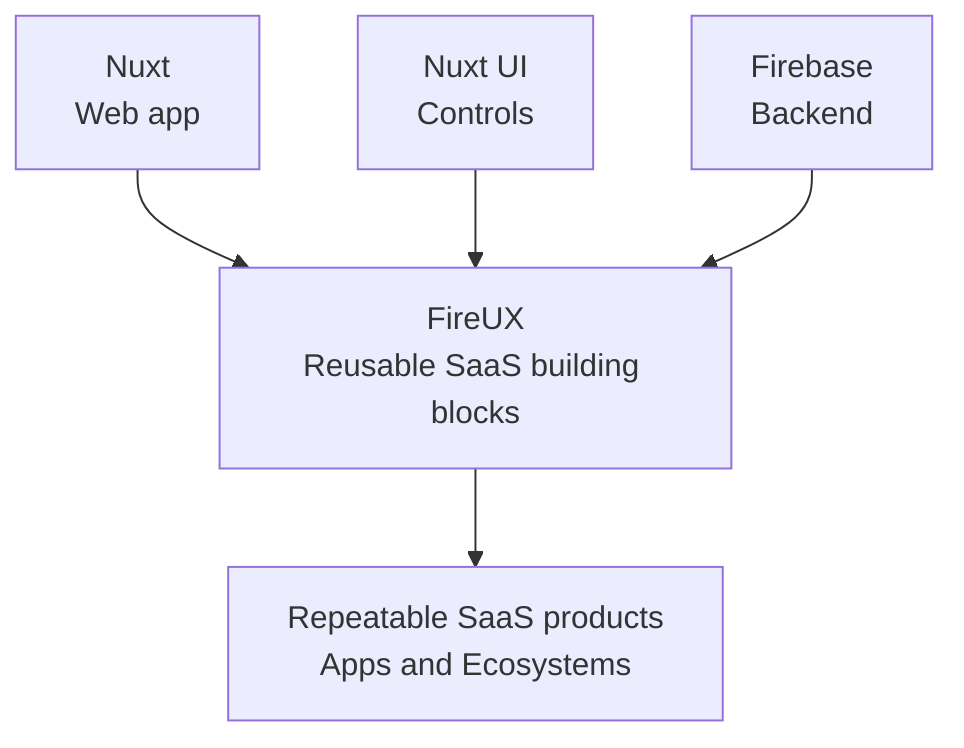

# FireUX platform map

Updated: 2026-10-26
Ref: ce2861c77
Role: map, not canon

## Purpose and authority

Use this as the short entrypoint from Nuxt, Nuxt UI and Firebase into the
FireUX-specific architecture. Official upstream docs own framework behavior.
This map and the linked FireUX contexts record package integration, product
ownership, data authority and intentional policy.

Current manifests, package registration and runtime source establish what is
implemented. Product decisions define the intended boundary. This map is not an
audit of every App, Entity or deployed Firebase target.

## Guiding principle

> Nuxt runs the web app, Nuxt UI supplies the controls, Firebase supplies the backend, and FireUX composes them into repeatable SaaS products.

FireUX supplies the shared product contracts and composition that let these
foundations work consistently across Apps. Ignition owns App scaffolding and
build reconciliation.

Use native behavior by default. Each FireUX abstraction must own a specific
product responsibility or resolve a demonstrated integration gap. Review it
against that responsibility before adding another layer.

## Platform foundations

| Foundation                    | Upstream documentation                                                                                                                                                                                                                                                                                                                                                                         | FireUX integration                                                                                                                                                                                                                                                                                                        |
| ----------------------------- | ---------------------------------------------------------------------------------------------------------------------------------------------------------------------------------------------------------------------------------------------------------------------------------------------------------------------------------------------------------------------------------------------- | ------------------------------------------------------------------------------------------------------------------------------------------------------------------------------------------------------------------------------------------------------------------------------------------------------------------------- |
| Nuxt 4 and Vue                | [Nuxt 4](https://nuxt.com/docs/4.x/getting-started/introduction), [modules](https://nuxt.com/docs/guide/concepts/modules), [layers](https://nuxt.com/docs/4.x/guide/going-further/layers)                                                                                                                                                                                                      | Core provides defineFireuxConfig and the shared Nuxt baseline. Apps select their Ecosystem and package layers; package modules register their owned runtime surfaces.                                                                                                                                                     |
| Nuxt UI 4                     | [Nuxt UI](https://ui.nuxt.com/docs/getting-started), [Nuxt installation](https://ui.nuxt.com/docs/getting-started/installation/nuxt), [theme and design system](https://ui.nuxt.com/docs/getting-started/theme/design-system)                                                                                                                                                                  | Core registers Nuxt UI and extends it with proved FireUX components, semantic styles and connected platform UI. Domains compose supported controls around domain workflows.                                                                                                                                               |
| Firebase JS SDK and Firestore | [Web Authentication](https://firebase.google.com/docs/auth/web/start), [Auth state](https://firebase.google.com/docs/auth/web/auth-state-persistence), [data model](https://firebase.google.com/docs/firestore/data-model), [realtime listeners](https://firebase.google.com/docs/firestore/query-data/listen), [Security Rules](https://firebase.google.com/docs/firestore/security/overview) | Ecosystem configuration binds the Firebase project and database. Core binds the configured Firebase runtime. Direct views use Firebase listeners; server projections use native Nuxt fetching and refresh after successful actions. Domain packages own canonical records, projections, permissions and trusted commands. |

FireUX extends these systems instead of maintaining replacement routers,
component libraries or database frameworks. Use the linked upstream docs for
API behavior; use the FireUX maps for local decisions.

## Framework and FireUX responsibilities

| Responsibility                                          | Native owner                       | FireUX addition                                                         |
| ------------------------------------------------------- | ---------------------------------- | ----------------------------------------------------------------------- |
| Routes, layers, SSR and request state                   | Nuxt                               | App routes and configuration; visible page and Workspace composition    |
| Controls, accessibility, appearance and toast lifecycle | Nuxt UI and its colour-mode module | Semantic tokens, named shared controls and deliberate feedback copy     |
| Clipboard access                                        | VueUse                             | Diagnostics serialization and feedback; no browser fallback engine      |
| Authentication and database subscriptions               | Firebase SDK and VueFire           | Configured project/database, App membership and domain scope            |
| Server data and commands                                | Nuxt/Nitro and Firebase Admin SDK  | Public projections, exact targets, validation and trusted authorization |

Use native `useColorMode()` for both resolved `value` and user `preference`.
Nuxt owns persistence, device changes and document-root classes. FireUX does not
add another preference store, observer or media listener. The appearance setting
is saved automatically; other feature-storage triggers remain explicit in the
[storage inventory](../../packages/core/fireux-core/src/config/privacy/browser-storage.json).

A helper must supply a FireUX rule or workflow. Import the narrower read, write
or path owner instead of bundling all CRUD helpers in a forwarding manager.
Safe diagnostics JSON and shared feedback remain useful responsibilities over
native clipboard/toast APIs. Unused storage abstractions have no place in the
runtime.

App-specific offline consent and owned cache cleanup remain real PWA policy.
Configured database selection, read outcomes, stale-command protection and
trusted domain permissions also remain FireUX responsibilities. Their presence
does not justify replacing the underlying framework mechanisms.

## Package and data ownership

App → Ecosystem → Extension → Core is the product ownership order. Dependencies
point down toward lower owners; not every App needs every layer.

- Apps own deployment, routes and adapters, configuration, brand, SEO and
  App-specific product composition.
- Ecosystems own real cross-extension products and bindings.
- Extensions own domain models, Entity capabilities, data authority and trusted
  behavior.
- Core owns shared Nuxt integration and product-neutral FireUX mechanics.

A Workspace, Dashboard or route is a surface over domain-owned data, not a new
storage authority. Client Rules, trusted server IAM and domain command checks
are separate boundaries. Public UI does not grant write access, and protected
records are not made safe by hiding them in Vue.

The accepted open-development Rules policy is explicitly scoped in the
[Firestore mutation context](../ai/firestore-mutations-context.md). It is not
shipping authorization. See [Entity storage](firestore-entity.md),
[Rules composition](firestore-rules.md), and
[Workspace ownership](family-workspace-entity.md) for FireUX-specific details.

## Current integration sources

- [Core App integration](../../packages/core/fireux-core/src/config/app/fireux.config.ts)
  adds the Core layer and baseline modules.
- [Nuxt module baseline](../../packages/core/fireux-core/src/config/app/nuxt-baseline.ts)
  registers Nuxt UI, Firebase integration and the shared Core module.
- [FireUX App composition](../../projects/fireux/fireux-app/nuxt.config.ts)
  selects the FireUX Ecosystem and its App-specific package layers.
- [Firebase Nuxt module](../../packages/core/fireux-nuxtfire/src/module.ts)
  configures the installed Nuxt Firebase runtime.
- [FireUX Ecosystem binding](../../packages/ecosystem/fireux-fireux/src/config/firebase/ecosystem.config.ts)
  supplies this Ecosystem's Firebase project and database.

## Navigation and maintenance

- [Repository map](fireux-mono.md) explains package lanes and reading order.
- [Nuxt integration](nuxt4.md) covers FireUX's module and layer choices.
- [Nuxt UI integration](nuxt-ui.md) covers the shared design-system boundary.
- [Firestore ownership](firestore-entity.md) and [Rules](firestore-rules.md)
  map the domain data and security boundaries.
- [Documentation roles](documentation.md) define how these maps stay current.

Refresh this map when the platform composition or ownership boundary changes.
Keep exact versions, release procedures and feature inventories in their
manifests or owning contexts rather than copying them here.
