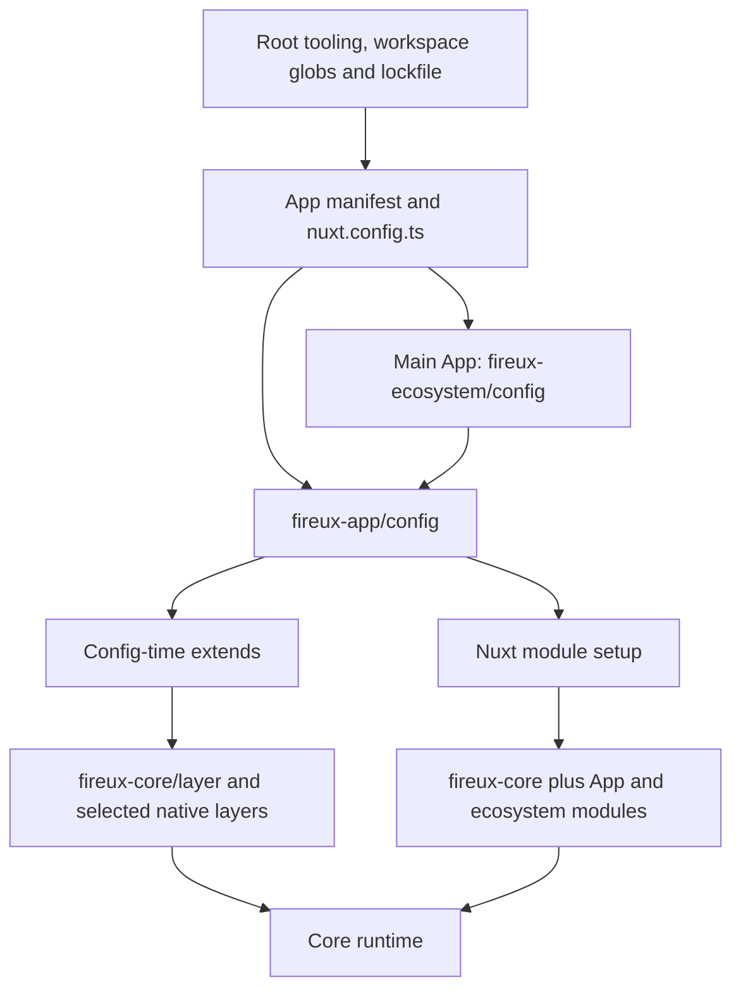

# FireUX Core reset · Stage 0 ownership and dependency audit

Updated: 2026-11-20
Ref: 6b457080d
Role: reviewed source inventory and proposed cutover

Stage 0 traces the repository spine from pnpm discovery through App assembly,
package exports and Nuxt registration into Core. It maps the ownership and
cutover dependencies for the reset and optional Workspace extraction.
The [Core reset handoff](../handoffs/2026-11-20-fireux-core-reset-build-order.md)
sets the implementation order. The [runtime map](../concepts/runtime-filesystem.md)
and [Core model map](../concepts/core-models.md) continue to describe the current
checkout until the relevant slice lands.

## Repository spine from root to runtime

The arrows follow the order in which a consumer reaches the runtime. The App
builder supplies both sides of the Core entry contract.

| Boundary | Observed ownership and dependency | Consequence for the reset |
| --- | --- | --- |
| [Root package](../../package.json), [workspace globs](../../pnpm-workspace.yaml), [install policy](../../.npmrc), [lockfile](../../pnpm-lock.yaml) | Five globs produce 65 members including the root, one Core library, 24 Extensions, eight Ecosystems, 29 Apps and two tools. All 65 have lockfile importers. Node 22 and pnpm 11 are pinned, and the root overrides keep Nuxt, Vue and Vue Router on shared versions. | A Workspace package under an existing library glob would be discovered automatically. Discovery alone installs or registers nothing in an App. Its manifest edges, lockfile links and App selection have to agree. Keep the shared framework versions across linked packages. |
| [Launcher discovery](../../tools/fireux-launcher/apps.mjs), [Codex map](../../tools/ide/codex-map.mjs) and [CI](../../.github/workflows/ci.yml) | Ports and commands come from App manifests and root scripts. The Codex map inventories source and declared dependencies. CI installs from the frozen lockfile and uses FireUX Blank for its Nuxt build baseline. | The launcher and inventory tools report the spine. Nuxt registers it. Blank exercises Workspace today, so the build baseline needs a complementary Core-only contract. |
| [App builder](../../packages/extensions/fireux-app/src/config.ts), [default layers and modules](../../packages/extensions/fireux-app/src/defaults.ts), [Main App wrapper](../../packages/extensions/fireux-ecosystem/src/config.ts) | All 29 App configs use these entrypoints, eight via the Main App wrapper and 21 directly. The wrapper adds shared Main App runtime. The builder adds the native App and Core layers, default Blogs, Products and AI modules and layers, and the selected ecosystem module. It keeps the supplied Core module tuple when present. It also sets up UI, Firebase, PWA, CSS and build defaults outside Core's own module and layer. | Prove the Core package with a direct host and the standard App contract with a real App. They exercise distinct dependency sets. An App's Workspace family list currently configures behavior and domain selection. The builder always includes Core, which still supplies the Workspace frame. |
| Family layers and modules | [FireUX Project](../../packages/ecosystem/fireux-fireux/src/config/app/project-layer.ts), [Misebox Kitchen](../../packages/ecosystem/fireux-misebox/src/config/app/kitchen-layer.ts) and [Granite Portfolio](../../packages/ecosystem/fireux-granite/src/config/app/portfolio-layer.ts) add native layers through config-time `extends`. Their [FireUX](../../packages/ecosystem/fireux-fireux/src/module.ts), [Misebox](../../packages/ecosystem/fireux-misebox/src/module.ts) and [Granite](../../packages/ecosystem/fireux-granite/src/module.ts) modules select domain dependencies from the App's Workspace families. Some domain modules [require their native layer to be present](../../packages/core/fireux-core/src/config/module/runtime-layer.ts). | Keep the family's config-time layer and setup-time module selection in step. Adding a module dependency cannot supply the native routes of a missing layer. Preserve the tenant and Main App choices during extraction. |
| [Core exports](../../packages/core/fireux-core/package.json), [repo TS aliases](../../tsconfig.base.json), [Node test loader](../../tools/ide/test-loader.mjs) | Core exports its module and native layer from authored source. Wildcard runtime subpaths expose deep implementation paths, including Workspace. Core, App and Ecosystem config exports have a production branch backed by generated artifacts. Repo TypeScript aliases resolve against source, and the test loader adds extensionless relative resolution for Node tests. | Check installed-package exports alongside source tests. Moving a runtime directory changes the public subpath for every direct importer. A source alias, generated Nuxt type declaration or green test alone cannot prove the installed export works. |
| [Build and release](../../package.json), [Core config build](../../packages/core/fireux-core/build/config.mjs), [package config build](../../tools/package-config/build.mjs), [Firebase release CLI](../../tools/firebase-release/cli.mjs) | Root App builds and typechecks generate Core config artifacts up front. App and Ecosystem build their own config artifacts. The release CLI uses Core's Rules composition and can build Core config during release preparation. | Keep build ordering and production export consumers in the map. Build and resolve the real config artifacts in the Stage 1 gate. Keep release and Rules authority with the existing tools and App owners. |

The manifest graph has no declared internal cycles or upward runtime edges
from Core to product packages, Extensions to Ecosystems, or libraries to
concrete Apps. Core is declared directly by all eight Ecosystems, 22
Extensions and all 29 Apps. A scan of 3,907 tracked TS, JS and Vue files in the
library and App members, excluding tests, fixtures, docs and generated output,
found one undeclared literal package import edge. Misebox's labour calculator
imports `fireux-finance`. The repo has a source alias for that package, but
Node resolution from the App returned `ERR_MODULE_NOT_FOUND`. This is a
pre-existing Misebox packaging issue outside the reset. Keep it separate if
using a full Misebox build as a later gate.
[Calculator](../../projects/misebox/misebox-app/app/components/Tools/RestaurantLabourCostCalculator.vue)

The relative-import scan also found three Granite contributors that reach
directly into the sibling Properties source tree for `usePortfolioWorkspace`.
All three declare `fireux-properties`, but these imports bypass its package
exports and depend on the checkout layout. Keep the Portfolio provider with
Properties and include these callers in the Stage 5 consumer check. Jobs
has a similar source import for a Places model, outside the Workspace
cutover. The FireUX and Misebox Apps also have explicit repo-relative
tooling imports for Ignition and release.
[Compliance](../../packages/extensions/fireux-compliance/src/runtime/portfolio/components/Workspace/Compliance/Index.vue),
[Documents](../../packages/extensions/fireux-documents/src/runtime/portfolio/components/Workspace/Documents/Index.vue),
[Tasks](../../packages/extensions/fireux-tasks/src/runtime/portfolio/components/Workspace/Tasks/Index.vue)

## What Nuxt actually registers

| Core entry | Owner and prepared result |
| --- | --- |
| [Native layer](../../packages/core/fireux-core/src/runtime/nuxt.config.ts) only | Discovers shared `Fire*` component directories, native pages, layouts, middleware and server files. The probe generated 18 top-level route entries including `/workspace`, the six Core layouts and global Workspace middleware. It did not generate the sampled Workspace component or composable registrations. |
| [Module](../../packages/core/fireux-core/src/module.ts) only | Registers Entity component groups, composable directories, type references, route policy, SEO hooks and explicit root handlers. The probe generated no native pages or layouts. It still registered `WorkspaceSidebar`, `useWorkspace`, `useAppUserRead` and `useUserRead`, plus the explicit sitemap and manifest handlers. |
| Layer and module together | Produces both sets of registrations. The layer owns native `server/api` discovery. The module explicitly registers root SEO and manifest handlers. Keep the two surfaces in the smoke test. Inspect the final Nitro method and route table before declaring a handler duplicate or removing one. |

All six App probes generated the Core Workspace entry, layout, middleware,
sidebar and auto-import, as well as the App membership and User readers. The
table counts generated top-level route entries whose paths start with
`/workspace`, including the shared entry.

| App | Selected family | Effective composition beyond the standard App layers | Workspace entries |
| --- | --- | --- | ---: |
| [Go QR](../../projects/fireux/go-qr/nuxt.config.ts) | None | FireUX ecosystem and Go QR modules. No domain Workspace layer. | 1 |
| [FireUX Blank](../../projects/fireux/fireux-blank/nuxt.config.ts) | Blank | App-owned Blank pages and the Bookings module. | 7 |
| [FireUX Platform](../../projects/fireux/fireux-app/nuxt.config.ts) | Project | Main App, Docs, FireUX Project and native Projects layers. | 15 |
| [Misebox](../../projects/misebox/misebox-app/nuxt.config.ts) | Kitchen | Main App, Misebox Kitchen and native Kitchens, Places, Businesses and Jobs layers. | 66 |
| [La Tap](../../projects/misebox/la-tap-berne/nuxt.config.ts) | Kitchen | Tenant App with Misebox Kitchen and native Kitchens and Places layers. The ecosystem module selects Kitchens even though the tenant's module list omits it. | 65 |
| [Granite](../../projects/granite/granite-app/nuxt.config.ts) | Portfolio | Main App and Granite Portfolio native composition with Properties, Compliance, Documents and Tasks. | 20 |

The temporary hosts used the current installed workspace and Nuxt prepare. Some
existing ecosystem and domain modules loaded through Nuxt's jiti fallback for
extensionless imports. The probes establish generated registration, while
production config export resolution, endpoint methods, rendering and live
authority each require their own evidence. Node resolution from Misebox
confirmed the sampled Core App and module config subpaths resolve to authored
files by default and generated `.mjs` files under the production condition.
The App and Ecosystem config production entrypoints also resolved to files.

## Current and proposed dependencies

Arrows point from a consumer to the dependency it uses.

| Consumer | Current dependency | Proposed boundary |
| --- | --- | --- |
| App assembly | `fireux-app` selects Core, the Ecosystem module and default App extensions even for Go QR | Preserve App bundle ownership. Prove Core directly through its module and layer, and prove the existing standalone App without Workspace. |
| Core App shell | Core Workspace helpers, components, layout and routes are present in the same package | Core owns the App entry and default manifest. The optional Workspace module contributes its own entry, layout, routes and install behavior through a neutral App integration point where needed. |
| Core Ecosystem | Core requires `project_id` in its model, canonical reader, provisioner and public projection. Core App configuration also requires `projectId`. | Core identity should work without a required Project relationship. Preserve the exact Project scope in the FireUX control plane before loosening the Core requirement. Keep existing stored values. |
| Core User and App session | User identity and App session both consume the same App membership reader | Keep one User identity and one App-owned membership reader. Move support definitions and behavior into App's existing roles during Stage 3. |
| Workspace consumers | Kitchen, Project, Property and other Apps import Core's Workspace implementation or rely on its Nuxt registration | Domain integrations explicitly select Workspace. Workspace depends on Core and stays independent of domain packages. Domain records and authority stay with their owners. |

The target arrows are **App assembly → Core and selected extensions**,
**Workspace → Core**, and **Workspace-enabled domain integration → Workspace and
Core**. No domain, Project or Workspace import belongs in universal Core.

The Stage 0 import scan inspected 586 tracked TypeScript, JavaScript and Vue
files under Core runtime, config, module, types and utilities. It found zero
static package specifiers naming another `fireux-*` package. That result covers
literal imports and re-exports. The present coupling is internal imports,
registration, runtime config, templates and stored field expectations.

## Ownership and placement matrix

Paths in the first column are relative to `packages/core/fireux-core/src/`
unless an App or package is named. Decisions are proposed by stage.

| Current path | Classification and current responsibility | Consumers and evidence | Decision |
| --- | --- | --- | --- |
| `runtime/nuxt.config.ts`, `runtime/pages/`, `runtime/layouts/`, `runtime/middleware/`, `runtime/plugins/`, `runtime/server/` | Native Nuxt layer. Registers Fire UI scans and supplies route, layout, bootstrap and HTTP entrypoints. The native trees include optional Workspace adapters today. | Bare Core host, Go QR, FireUX Blank. Generated layouts and routes below. | **Keep** native roles and thin adapters in Stage 1. Move Workspace adapters with their layer in Stage 5. |
| `module.ts`, `config/module/{module-wiring,module-helpers,components-config,pages-config,assets-config}.ts` | Core registration and reusable module mechanics. The module adds composable scans, component groups, route transition policy, SEO/manifest handlers and generated catalogue data. | Core-only host and extensions using the exported registration helpers. Workspace and AppUser scans are explicit. | **Simplify** registration by proving which layer or module owns each entry. Transfer Workspace's scans in Stage 5. Keep public names until their consumers move. |
| `config/app/`, `config/module/{ecosystem-wiring,reserved-route-keys}.ts`, `config/firebase/`, `config/privacy/`, `types/`, `utils/` | Universal App assembly, runtime config, Firebase setup, privacy and public route policy. Includes project and Workspace config requirements today. | `fireux-app/src/config.ts`, `fireux-ecosystem/src/config.ts` and ecosystem entry modules. Package exports distinguish authored and production config. | **Keep** neutral policy. **Simplify** Core Project requirements in Stage 2. Transfer Workspace-only configuration behavior in Stage 5 after inventorying real assembly callers. |
| `runtime/composables/fireux/firebase/`, `runtime/composables/fireux/firestore/`, `runtime/composables/fireux/commands/`, `runtime/utils/firestore-mutations/`, `runtime/server/utils/` | Universal auth, data transport, guarded command and request mechanics. | App and User sessions, membership readers and optional-domain commands. | **Keep** scoped access, listener and transaction semantics. Verify independently of Workspace in Stage 4. |
| `runtime/composables/{forms,http,media,navigation,public,pwa,shared,ui}/`, `runtime/components/{Auth,Collection,Context,Create,Dashboard,Diagnostics,Onboarding,Provider,Pwa,layouts,molecules}/` | Mixed shared UI and technical glue. Includes domain-neutral controls, App account UI, and Workspace entry integrations. | The Core public component catalogue, native default and Dashboard layouts, and existing extensions. | **Keep** universal controls. **Simplify** mixed ownership by removing downstream assumptions and leaving domain-specific compositions with their owners. Keep neutral Dashboard and account navigation usable without Workspace. |
| `runtime/assets/`, `runtime/public/`, `runtime/models/utils/stamps.model.ts`, `runtime/types/`, `runtime/utils/`, `runtime/tools/{types.ts,files/}` | Shared presentation assets, record primitives, technical contracts and file tooling. The shared CSS includes Workspace rules and Dashboard uses layout classes named `workspace-*`. | Core public/profile shells, Workspace, Dashboard and domain surfaces. | **Keep** neutral styles and primitives. **Move** Workspace-owned CSS only after verifying its selectors in Dashboard and other consumers. A shared class name alone does not establish ownership. |
| `runtime/composables/diagnostics/useDiagnosticsUi.ts`, `runtime/app/components/DevControls.vue` | Neutral dev controls with a domain route allowlist in Core. | `fireux-properties/src/runtime/portfolio/components/Create/System.vue` and `fireux-suppliers/src/runtime/supplier/components/Create/System.vue` read note visibility. The allowlist also names Kitchen paths. | **Simplify** after the Stage 1 registration gate. Remove industry route assumptions from Core and let actual dev-note owners declare eligibility. Preserve visibility state and dev-only behavior. |
| `runtime/app/models/model.ts`, `runtime/app/{composables,server,components}/` | Core App Entity. Owns selected App identity, configured `ecosystem_id`, App initialization, App context, branded assets and App-level readers. | `app/server/detail/read.ts`, `app/server/initialization/initialize.ts`, `app/composables/useAppSession.ts`, `FireuxApp.vue` and App administration routes. | **Keep** canonical identity and App-owned administration. Prove roots in Stage 2. Split the Workspace-specific entry and install behavior in Stage 5. |
| `runtime/app/{contracts,literature,media,utils}/`, `runtime/app/server/{chat,events,initialization}/` | App-owned support and infrastructure. Literature types import Workspace capability-family vocabulary. App chat and join publication have separate server lifecycles. | Authored App metadata and `/api/chat`, internal join events, and App bootstrap. | **Keep** App-level contracts where independently consumed. **Review** chat’s optionality in Stage 4 and **simplify** the Workspace vocabulary dependency in Stage 5. |
| `runtime/ecosystem/models/{ecosystem.model.ts,ecosystem-directory.ts}`, `runtime/ecosystem/server/{identity,directory}/`, `runtime/ecosystem/{composables,components}/` | Core Ecosystem Entity and public projection. Core reads and provisions the identity record. Project membership of the Ecosystem is currently required. | Core `/api/ecosystems`, App initialization, FireUX portal `server/project/ecosystem/read.ts`, `server/utils/apps.ts` and Project Apps. | **Keep** the identity and reader. **Simplify** Project coupling by first protecting exact Project-filtered operations in their owner. Remove the requirement for non-Project Core paths only when those consumers are reconciled. |
| `runtime/user/models/user.model.ts`, `runtime/user/{composables,components,server,utils}/` | Core User Entity, canonical profile and identity plus private account support. | `useUserRead`, `useUserSession`, public identity/profile endpoints and authorized `user/server/user-account/provision.ts`. | **Keep** one person identity and separate access for private account data. Private account, handle, profile, notification and reference lifecycles remain with User. |
| `runtime/app/app-user/{models,types.ts,contracts,utils}/` | App-owned support record currently represented as a nested technical spine. | App session and User session both read it via `useAppUserRead`. `user/server` uses the reference as a locator when the App database differs. | **Move** the membership definition into App records in Stage 3. Preserve `apps/{appId}/users/{uid}` and the User-side locator `users/{uid}/apps/{appId}` in their existing databases. |
| `runtime/app/app-user/{composables,components,server}/`, `runtime/server/api/internal/app/membership.post.ts` | App membership read, access and trusted command behavior. | App administration, header badge, User detail/edit, App session, Workspace navbar and domain access checks. | **Move** behavior into App's established technical roles in Stage 3. Cut over component registration and explicit imports together. Preserve role, subscription, stamps and command authorization. |
| `runtime/workspace/{components,composables,models,server,tools,utils}/` | Optional Workspace presentation and selection currently in Core. Includes shared Team coordination, not a domain grant owner. | Blank reference, FireUX Project, Misebox Kitchen, Granite Property/Portfolio, Supplier and Business. | **Move** Workspace as a single explicitly selected integration in Stage 5. Keep domain authority, role records and commands in each domain. |
| `runtime/layouts/workspace.vue`, `runtime/middleware/fireux-workspace.global.ts`, `runtime/pages/workspace/index.vue`, `runtime/pages/dashboard/workspace.vue` | Workspace integration currently supplied by the Core layer. The middleware handles family entry and access routing. | Generated Core-only `/workspace`, Blank routes, domain workspace layout selection. | **Move** the native Workspace adapters to the optional package. Reconcile auth and route defaults to named route intent before removing Core's Workspace paths. |
| `runtime/app/composables/useAppManifest.ts`, `runtime/server/manifest.webmanifest.get.ts`, `runtime/plugins/pwa.client.ts` | App PWA and manifest have mixed ownership today. Client calls Workspace entry helpers. The server also validates Workspace start URL independently. | `FireuxApp.vue`, browser install behavior and tests covering Workspace origin and entry. | **Keep** App manifest/provider behavior. **Move** Workspace-specific input and validation to its owner through an explicit optional seam. Preserve default App manifests and safe start URLs, including configured origins. |
| `runtime/tools/catalogue.ts`, `runtime/workspace/tools/team/create-member.ts` | Core tool discovery imports a Workspace Team primitive. | Tool catalogue readers and Workspace team tools. | **Move** the Team primitive contribution with Workspace. Keep neutral tool definitions Core-owned. |
| `runtime/server/api/{chat,proxy,diagnostics}/`, `runtime/server/api/live.post.ts`, `runtime/pages/{chat.vue,assets.vue,diagnostics/}` | Mixed App features and neutral technical adapters. Optionality, exact dependencies and supported exports require further consumer checks. | App chat, live read transport, diagnostics, media and public access. | **Verify** in Stage 4 before relocating. No duplicate authority or safe deletion established in Stage 0. |

## Dependency edges that govern the cutover

- **Project is required in Core semantics today.** The Core model, reader,
  directory projection and provisioner use `project_id`. Core
  `config/app/validate.ts` and `app/composables/config/FireUXConfig.ts` require
  `projectId`; `app/server/initialization/initialize.ts` uses its equality with
  `ecosystemId` to decide whether to provision a Main App's Ecosystem. FireUX
  control-plane code filters Project-to-Ecosystem results by the stored value.
  Removing only the TypeScript field would leave failed reads or weaken that
  scope. Verify the legitimate Core bootstrap rule and split the Project
  management relationship in Stage 2 before changing canonical validation.
  Firebase provider `projectId` remains its own infrastructure identifier.
- **Membership has a record owner and a locator.** App membership role and
  subscription belong to the App-scoped record. User identity and User-side
  locator retain their existing lifecycles. App initialization and membership
  commands both participate in the same App membership lifecycle with
  different entry conditions. The audit did not establish competing record
  owners. Keep the guards and exact target paths during the Stage 3 move.
- **Workspace has 11 incoming literal import edges from nine Core runtime
  files outside its folder.** They are `app/composables/useAppManifest.ts`
  (two), `app/literature/types.ts`, `components/Dashboard/Overview/App.vue`,
  `components/layouts/default/Header.vue`, `composables/navigation/useDashboardNav.ts`,
  `middleware/fireux-workspace.global.ts` (two), `pages/dashboard/workspace.vue`,
  `pages/workspace/index.vue`, and `tools/catalogue.ts`. Registration, App config,
  CSS and native-layout use form additional edges. Reconcile those before
  moving the directory.
- **Default App composition already has a Workspace dependency outside
  Core.** The source scan found 185 files in 18 other members directly
  importing `fireux-core/runtime/workspace/*`. Kitchens, Properties, Projects
  and Suppliers account for 141 files. The remaining consumers include
  default App index operations importing [capability-family vocabulary](../../packages/extensions/fireux-app/src/runtime/app/server/index/operations.ts),
  default AI importing [the Test Intent contract](../../packages/extensions/fireux-ai/src/runtime/server/utils/test-intent.ts),
  and Marketplace moderation calling a
  [Workspace Team member resolver](../../packages/extensions/fireux-marketplace/src/runtime/marketplace-store/server/moderation/commands.ts).
  Classify these contracts by responsibility. Preserve a Workspace-free
  dependency path through the default App and AI modules while letting
  Workspace-enabled integrations select the optional package explicitly.
  Direct import counts exclude generated tags, auto-import calls, named
  layouts, CSS and route metadata.
- **Workspace behavior spans both entrypoints.** Runtime config carries
  `workspaces` and `workspaceConfig` from App assembly. Core's page transition
  policy, auth middleware, Tailwind source scan, public and Dashboard
  navigation, and client and server manifest logic also know about Workspace.
  Extract only once these consumers have an explicit owner. Preserve the
  shared Dashboard shell and App install behavior on the no-Workspace path.
  Keep the per-family access checks and safe PWA start URL validation on
  the enabled path.
- **The likely broken consumers are concrete.** Extracting Workspace by
  moving the directory alone breaks the importers above, direct consumers in
  Kitchens, Properties, Projects, Suppliers, Businesses, and the Blank and
  FireUX Apps, plus generated `Workspace*` tags and `layout: 'workspace'`
  consumers. Moving App membership alone breaks the default header and
  Dashboard subscription controls, User membership panels, and domain access
  imports. These are anticipated move-only failures. Stage 0 introduced none.

## Reference Apps and gates

| Reference | Stage 0 baseline | What the reset must prove |
| --- | --- | --- |
| Core module and layer only | Temporary Nuxt host, generated without another FireUX package. `workspaces: []` still produced `/workspace`, the Workspace layout, three sampled Workspace components, four sampled Workspace composables and App membership imports. | Extend the existing temporary Nuxt prepare test technique for the strict Core-only gate. After Stage 5, require the absence of Workspace implementation registrations and routes. Prove the Core App, User and membership journeys independently at their actual authenticated boundary. |
| [Go QR](../../projects/fireux/go-qr/nuxt.config.ts) | Existing standalone App, with `workspaces: []`. Nuxt prepare still generated `/workspace`, its layout, sidebar and entry helper. It selects Go QR and standard App extensions. | Real no-Workspace consumer. Verify its public page, App manifest, sign-in and membership work after Workspace becomes optional. Use the module-only host for package independence. |
| [FireUX Blank](../../projects/fireux/fireux-blank/nuxt.config.ts) | Existing narrow Workspace App with `workspaces: ['blank']`. Nuxt prepare generated Blank Identity, Overview, Team, Test, Calendar and Create, plus the Workspace entrance and layout. | Verify direct Workspace opt-in, selection, scoped reads, access, navigation, and Team after extraction. Use the real FireUX Project App as a follow-up for Project-owned consumers. |

Prepared output proves Nuxt registration. Rendered pages, authentication and
live data operations require separate evidence.

| Run | Passed | Scope |
| --- | ---: | --- |
| Stage 0 initial Core audit | 86 | Core identity, App initialization, User and membership readers, Workspace entry, selection and Team behavior. |
| Stage 0 repository spine extension | 85 | Core registration, App composition and package artifacts, Main App hosting and repository tooling. This is a separate selection with some overlap. |
| Stage 1 focused regression | 91 | The 85-test spine selection plus six tests of Core installation, production exports and reference App composition. |

## Stage 1 implementation sequence

1. **Core module alone.** Install the packed Core package through its module
   export. Verify explicit component groups, App and User reader auto-imports,
   and root manifest and SEO handlers.
2. **Core layer alone.** Install the native layer through `fireux-core/layer`.
   Verify pages, layouts, global middleware, shared components and native
   Nitro endpoints.
3. **Both together and production exports.** Verify that the combined host has
   both sets of registrations, including GET App status and manifest and POST
   App membership. Import the generated App and module config entrypoints
   from the packed package under Node's production condition. This exposed a
   missing compiled page-layout utility used by the page and ecosystem
   configuration exports. The existing config build now generates and ships it.
4. **Reference Apps.** Prepare Go QR with no selected Workspace family and
   FireUX Blank with its Blank family. Both resolve Core and generate the
   expected routes. Go QR still gets Core's shared Workspace registrations.
   Removing those from the no-Workspace path belongs to Stage 5.
5. **Developer controls.** With the installation gate passing, remove Core's
   static industry route allowlist. The two Portfolio and two Supplier creation
   pages declare note availability through Nuxt page metadata. Their existing
   components still own the notes. Core retains the shared toolbar and
   visibility state. Granite and Bringli prepare the four intended note
   routes, and Go QR prepares none. A local browser fixture exercised the
   actual toolbar and note components through show, hide and copy on those
   routes, with the route context and clipboard supplied by the fixture.
   Signed-in App rendering was outside that check.

The [Core installation tests](../../packages/core/fireux-core/src/test/installation.test.mjs)
exercise steps 1–4. Reconcile the Project relationship in Stage 2, App
membership in Stage 3 and Workspace in Stage 5 as separate cutovers.

## Stages 4–5 ownership review

Source snapshot: `c457e5ea2`. This section updates the cutover proposal and
uses the earlier tables as the historical Stage 0 baseline. App configuration
now supports Project-free Apps. The trusted developer endpoint composes the
Main App bootstrap, and AppUser is already an App-owned record. Both stay
outside this extraction.

### Ownership inventory

| Owner | Keep or relocate | Boundary |
| --- | --- | --- |
| Universal Core | Nuxt module and layer mechanics; Firebase/Auth, guarded Firestore and request tooling; App, Ecosystem and User identity; AppUser membership; the App shell, neutral Dashboard, UI primitives and App PWA defaults. | Core owns authorization and persistence for its records. Workspace may consume those contracts. |
| Optional Workspace | Family selection and switching, selected-record scope, Workspace entry and navigation, shell and page framing, Team presentation, Workspace tool registration and install behaviour. | The optional package registers its own components, composables, routes, middleware, layout and CSS sources. Keep existing route and component names for enabled consumers. |
| Domain extensions and Apps | Project and domain access grants, Team role policy and write authority, entity records and capability screens. Product and platform directory composition belongs to the Apps or Ecosystems that supply it. | Keep canonical storage and authorization with the same owner. Shared roster mechanics may move with Workspace only after checking callers outside Workspace. |

### Dependency map

| Current edge | Actual consumer and proposed disposition |
| --- | --- |
| [Core module](../../packages/core/fireux-core/src/module.ts) and [component registration](../../packages/core/fireux-core/src/config/module/components-config.ts) register Workspace imports and `Workspace*` components. [Core stylesheet](../../packages/core/fireux-core/src/runtime/assets/styles/main.css) scans Workspace components. | Transfer discovery to the optional package. Separate Workspace styles from styles that the neutral Dashboard currently shares. Verify both layouts before removing or relocating selectors. |
| The Core layer discovers [the Workspace layout](../../packages/core/fireux-core/src/runtime/layouts/workspace.vue), [entry page](../../packages/core/fireux-core/src/runtime/pages/workspace/index.vue), [Dashboard bridge](../../packages/core/fireux-core/src/runtime/pages/dashboard/workspace.vue) and [global Workspace middleware](../../packages/core/fireux-core/src/runtime/middleware/fireux-workspace.global.ts). Core [auth middleware](../../packages/core/fireux-core/src/runtime/middleware/fireux-auth.global.ts) currently skips this route family. | Move these native entries together. Preserve availability checks, auth ordering and the Kitchen Dashboard redirect. Replace the Core auth exception with a neutral route mechanism only if required by the opt-in integration. |
| [Header](../../packages/core/fireux-core/src/runtime/components/layouts/default/Header.vue), [Dashboard navigation](../../packages/core/fireux-core/src/runtime/composables/navigation/useDashboardNav.ts) and [Dashboard App overview](../../packages/core/fireux-core/src/runtime/components/Dashboard/Overview/App.vue) call Workspace entry directly. | Core keeps the shells and App controls. Workspace supplies its entry links and visibility. Review existing navigation and layout composition seams before adding one. |
| [App manifest composable](../../packages/core/fireux-core/src/runtime/app/composables/useAppManifest.ts) imports Workspace route and entry code. The [manifest handler](../../packages/core/fireux-core/src/runtime/server/manifest.webmanifest.get.ts) separately validates family, origin and start URL. [App config](../../packages/core/fireux-core/src/runtime/app/composables/config/FireUXConfig.ts) normalizes Workspace policy. | Preserve the default App manifest. Place Workspace install and family policy with the optional owner and verify the client and server agree. Keep unsafe URL rejection and the documented tenant origin behaviour. |
| [Tool catalogue](../../packages/core/fireux-core/src/runtime/tools/catalogue.ts) imports the Workspace Team primitive. [App literature](../../packages/core/fireux-core/src/runtime/app/literature/types.ts) and the default [App Operations endpoint](../../packages/extensions/fireux-app/src/runtime/app/server/index/operations.ts) use Workspace capability vocabulary. | Keep neutral discovery in Core. Workspace contributes its tools and operations. Decide ownership of descriptive vocabulary separately from executable capability registration so default App builds stay independent. |
| Default [AI Test intent](../../packages/extensions/fireux-ai/src/runtime/server/utils/test-intent.ts) consumes a Workspace type and serves Project and Kitchen Test routes. [Marketplace moderation](../../packages/extensions/fireux-marketplace/src/runtime/marketplace-store/server/moderation/commands.ts) imports the Team member resolver for identity lookup. | Resolve these two consumers before repointing imports. Test-specific behaviour should live with the optional feature and consume neutral AI generation. Marketplace needs scoped User lookup, not a dependency on the Workspace Team runtime. Preserve the existing directory eligibility check. |

A literal scan of TypeScript and Vue sources found **187 files across 18
non-Core package/App roots** importing `fireux-core/runtime/workspace/`.
Kitchens (52), Properties (37), Projects (32) and Suppliers (22) account for
143 of them. Blank, Businesses, Misebox and the portal have direct imports
too. The scan excludes auto-import calls, generated component tags, layout
metadata and CSS. Treat each of those as a separate cutover edge.

### Proposed removal and cutover order

1. Establish the negative and positive fixture assertions below. First verify
   the neutral Auth, App, User and membership paths without relying on a
   Workspace route. Use Go QR to check a real no-Workspace App and Blank
   as the first opt-in consumer.
2. Resolve Core shell, navigation, manifest, metadata and tool contributions.
   Remove Core's Workspace-specific registrations and App-level calls when
   their opt-in equivalents exist. The diagnostics-only
   `canOwnMultipleWorkspaces` session field is a removal candidate. Actual
   capacity checks remain with the enforcing capability.
3. Transfer the native Workspace entries and implementation with their
   consumers. Include the default App/AI and Marketplace edges above,
   then migrate the explicit domain imports and registration in dependency
   order. Remove the old Core implementation and imports at cutover. Keep
   existing data paths and command authority.

### Acceptance test for the packed Core fixture

Extend [the existing installation test](../../packages/core/fireux-core/src/test/installation.test.mjs).
Its current assertions expect Workspace registrations under both installation
modes. Change that contract at cutover and retain the positive assertions for
Core's own public surface.

- Prepare packed Core **module alone, layer alone, and both** in the existing
  temporary Nuxt host. Verify the optional Workspace package cannot resolve
  from that host. Check the archive and production import graph for leftover
  Workspace implementation and reverse imports, including type-only imports.
  Check the generated registry for the absence of the `workspace` layout,
  Workspace middleware, `WorkspaceSidebar`, `useWorkspace`,
  `/workspace` and `/dashboard/workspace` and their child routes. Also check
  CSS discovery and Nitro handlers for Workspace sources.
- Keep Core registration assertions appropriate to each install mode.
  The combined host must still expose App status, membership, App manifest,
  and its normal auth and User entrypoints. Exercise a signed-in emulator
  journey through canonical User setup, App read, explicit Join and repeat
  Join, then sign out. Generated files verify registration. The signed-in
  journey verifies the actual consumers and stored result.
- Verify Go QR's normal homepage and App manifest with no Workspace entries.
  Verify Blank with the optional package enabled, including layout and
  routes, authorized selection and switching, denied access, and Workspace
  manifest deep-link validation. Use the Project portal as the next check
  for domain Team and Project-specific authority.

This review authorizes no source moves. The cutover and its acceptance
checks remain pending review.

### Slice 3 verification checkpoint

Slice 3 moved the shared Workspace runtime and native Nuxt entries into
`fireux-workspace`. The strict packed Core gate passed 10 checks, including
module-only, layer-only and combined installs with Workspace unavailable,
and the signed-in account journey against local Firebase emulators.

Go QR rendered pricing without Workspace. FireUX Blank rendered its opted-in
Workspace home and overview and loaded the Workspace stylesheet and manifest.
The signed-in fixture rendered the Misebox Chef Dashboard editor with Core
and the Chef capability. Saving a Chef profile and running the full Misebox
App remain unverified.

The broader Core suite passed 1,203 of 1,217 tests. The same 14 failures were
reproduced against Slice 2 (`394b3fc2d`) and remain open:

| Cases | Failing contract |
| --- | --- |
| 2 | Menu pagination retry and Kitchen collection read outcomes fail because their fixtures do not supply `useApiRead`. |
| 1 | Team collection composition fails its empty-state assertion. |
| 7 | Kitchen Test command-scope cases point at the retired `useKitchenWorkspaceTest.ts` fixture source. |
| 4 | Project create, update, delete and App create membership-replacement cases fail because their fixtures do not supply `resolveAppUserAccess`. |

Workspace package validation and external consumer migration remain separate
from this checkpoint. Migrate shared extensions before their dependent Apps,
then run the integration gate and verify the retired Core Workspace path
has no callers.
